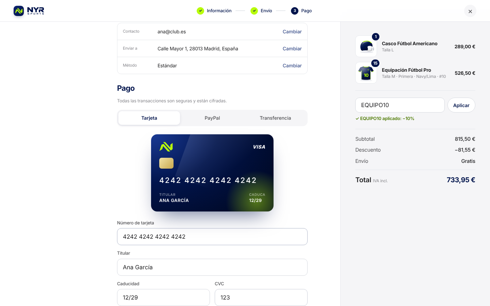

# NYR Sports — Web e-commerce

Landing y tienda online minimalista (estética Apple) de NYR Sports: uniformidad deportiva multimarca (fútbol, baloncesto, vóley, balonmano…) y distribución exclusiva de Forelle en la Península, Baleares y Canarias.
Navy `#01144C` para estructura, lima `#B8FC0B` para llamadas a la acción. HTML/CSS/JS sin dependencias.

## Ver en local
```bash
npx serve .
```

## Estructura
- `index.html` — landing, catálogo, modal de producto, bolsa y checkout
- `css/styles.css` — sistema de diseño y responsive
- `js/app.js` — catálogo (`PRODUCTS`), configurador de uniformes, bolsa, checkout
- `js/art.js` — renders SVG de producto
- `assets/logo.svg` — icono de marca (favicon)
- `assets/brand/` — logo oficial: originales, símbolo SVG, versiones PNG blanca/navy y versión cristal
- `assets/img/hero.jpg` — (opcional) foto de hero; si existe se muestra sobre la composición
- `obsidian/NYR-Sports/` — vault de Obsidian con diario y documentación del proyecto

> El pago es una simulación de UX. Para producción conectar Stripe / Redsys / Bizum y un backend de pedidos.


